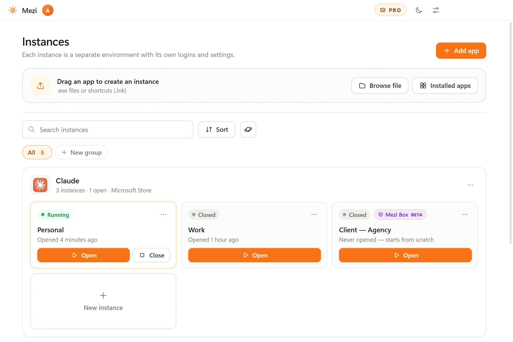

# Mezi

### Two accounts of the same app, open at the same time

Mezi opens any Windows app in isolated instances. Keep your personal and work accounts of Claude, ChatGPT, Discord or VS Code open side by side, each with its own logins, settings and cache.

**[Download for Windows](https://meziapp.net/downloads/Mezi-Setup.exe)** · [Website](https://meziapp.net/en/) · [Guides](https://meziapp.net/en/guides) · [All versions](../../releases) · [Português](README.pt-BR.md)

  

<picture>
  <source media="(prefers-color-scheme: dark)" srcset="assets/mezi-dark.webp">
  
</picture>

## Why Mezi

Many desktop apps only show one account at a time. Switching means signing out and back in, or missing what happens in the other account.

With Mezi, each instance gets its own data folder, so it starts as if the app had never been opened on your PC. The program is the one you already have: nothing is installed twice, and your normal app stays as it is.

## Features

- **Separate logins.** The accounts, settings and cache of each instance never mix with the others or with your normal app.
- **Regular programs and Microsoft Store apps.** Drag in an `.exe` or a shortcut, or pick from the list of installed apps.
- **Your folders close at hand.** Documents, Downloads and your projects stay available inside each instance, and you can turn each one off.
- **Links go where you choose.** When an instance opens a link, it can open in an isolated browser or in your usual one.
- **Mezi Box (beta).** Mezi's own sandbox, with no driver to install. Apps can only write inside the instance.
- **The basics.** 8 languages, dark mode, automatic updates and no ads.

## Get started

1. [Download Mezi](https://meziapp.net/downloads/Mezi-Setup.exe) and install it (Windows 10 or 11, 64-bit).
2. On first launch, choose the folder where your instances will live.
3. Add an app: drag in an `.exe` or a shortcut, or pick an installed app.
4. Click **Open** and sign in to your other account.

Mezi works without an account on the free plan.

## Guides

- [How to use two Discord accounts at the same time on PC](https://meziapp.net/en/guides/two-discord-accounts)
- [How to use two Claude accounts at the same time on Windows](https://meziapp.net/en/guides/two-claude-accounts)
- [How to use two ChatGPT accounts in the Windows app](https://meziapp.net/en/guides/two-chatgpt-accounts)
- [How to open VS Code with two GitHub accounts at once](https://meziapp.net/en/guides/vscode-two-github-accounts)
- [How to keep work and personal accounts apart on one PC](https://meziapp.net/en/guides/separate-work-and-personal)
- [How to try a program on Windows without touching your PC](https://meziapp.net/en/guides/test-programs-safely)
- [Sandboxie alternative for Windows: how Mezi Box works](https://meziapp.net/en/guides/sandboxie-alternative)

## Isolation modes

Each instance chooses its own mode.

| | Lite (default) | Mezi Box (beta) |
| --- | --- | --- |
| Separate logins, settings and cache | Yes | Yes |
| Driver or extra install | No | No |
| Account | Not needed | Free account |
| Blocks writes outside the instance folder | No | Yes, enforced by Windows |
| Apps can read files on your PC | Yes | Yes |

Mezi Box runs apps at a low integrity level inside a Windows Job Object. Writes outside the instance folder get "access denied". Sandboxie redirects those writes instead, so some apps that work there may not work in Mezi Box. Mezi Box is not an antivirus.

## What Mezi doesn't do

- **Apps limited to one copy per PC.** Steam and many game launchers won't open a second copy.
- **Games with anti-cheat.** Games like Roblox and Valorant may block sandboxes, and some forbid multiple accounts. Mezi doesn't bypass anti-cheat, so check each game's rules.
- **Apps that require administrator rights.** These aren't supported.
- **Everything saved outside the profile.** In Lite mode, apps that keep the account in the Windows Registry or Credential Manager share that part between instances.
- **Sign-in links for Microsoft Store apps.** Windows sends these links straight to the app, so sign in from the app's own window, with an email code for example.
- **Extra features or limits.** Each account keeps the limits and rules of its own service. Check each service's terms about using multiple accounts.

## Plans

| | Free | Pro |
| --- | --- | --- |
| Instances | Up to 2 per app | Unlimited |
| Apps | Up to 5 | Unlimited |
| Open at once | 1, alongside your normal app | As many as you want |
| Extras | Lite mode and Mezi Box (beta) | Groups, templates, PIN or Windows Hello lock, disposable instances and Clone |
| Support | | Priority support |

[Compare the plans](https://meziapp.net/en/pro)

## Safety and privacy

- **"Windows protected your PC".** The installer isn't digitally signed yet, so Windows may show this warning. Click **More info** and then **Run anyway**.
- **Check your download.** Each [release](../../releases) lists the SHA-256 of the installer. In PowerShell: `Get-FileHash .\Mezi-Setup.exe -Algorithm SHA256`
- **Your data stays on your PC.** Instances live in the folder you choose. Mezi doesn't send your apps' data to the internet or send error reports. Since version 0.4.0, while it's open and online, it sends a random install code, the version and usage time; you can turn this off in Settings. The version from the website checks meziapp.net for updates when it opens and every 6 hours.
- **The account is optional.** You only need one, free, for Mezi Box, support and Pro. Read the [privacy policy](https://meziapp.net/en/privacy).
- **The source code isn't public.** This repository holds the releases and public feedback.

## Feedback

[Open an issue](../../issues/new) to report a bug or to say whether an app worked. For account or payment questions, write to contact@meziapp.net.

---

Claude, ChatGPT, Discord, Steam, Sandboxie and other brands mentioned belong to their owners. Mezi is not affiliated with them. See the [terms of use](https://meziapp.net/en/terms).
