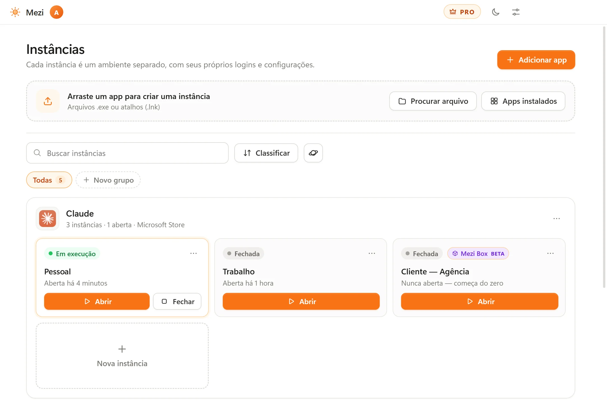

# Mezi

### Duas contas do mesmo app, abertas ao mesmo tempo

O Mezi abre qualquer aplicativo do Windows em instâncias isoladas. Deixe suas contas pessoal e do trabalho no Claude, no ChatGPT, no Discord ou no VS Code abertas lado a lado, cada uma com seus próprios logins, configurações e cache.

**[Baixar na Microsoft Store](https://apps.microsoft.com/detail/9N76QS4Q93N6)** · [Instalador (.exe)](https://meziapp.net/downloads/Mezi-Setup.exe) · [Site](https://meziapp.net/) · [Guias](https://meziapp.net/guias) · [Todas as versões](../../releases) · [English](README.md)

  

<picture>
  <source media="(prefers-color-scheme: dark)" srcset="assets/mezi-dark.pt-BR.webp">
  
</picture>

## Por que usar o Mezi

Muitos apps para desktop só mostram uma conta por vez. Para trocar, você precisa sair e entrar de novo, ou fica sem ver o que acontece na outra conta.

Com o Mezi, cada instância tem a própria pasta de dados, então ela começa como se o app nunca tivesse sido aberto no PC. O programa é o que você já tem: nada é instalado duas vezes, e o seu app normal continua como está.

## Recursos

- **Logins separados.** Contas, configurações e cache de cada instância nunca se misturam com as outras nem com o app normal.
- **Programas comuns e apps da Microsoft Store.** Arraste um `.exe` ou um atalho, ou escolha na lista de apps instalados.
- **Suas pastas por perto.** Documentos, Downloads e seus projetos continuam acessíveis em cada instância, e dá para desligar cada um deles.
- **Os links abrem onde você escolher.** Quando uma instância abre um link, ele pode abrir num navegador isolado ou no seu navegador de sempre.
- **Mezi Box (beta).** O sandbox próprio do Mezi, sem driver para instalar. Os apps só conseguem gravar dentro da instância.
- **O básico.** 8 idiomas, modo escuro, atualização automática e nenhum anúncio.

## Como começar

1. Instale o Mezi pela [Microsoft Store](https://apps.microsoft.com/detail/9N76QS4Q93N6) ou [baixe o instalador](https://meziapp.net/downloads/Mezi-Setup.exe) (Windows 10 ou 11, 64 bits).
2. Na primeira abertura, escolha a pasta onde as instâncias vão ficar.
3. Adicione um app: arraste um `.exe` ou um atalho, ou escolha um app instalado.
4. Clique em **Abrir** e entre na sua outra conta.

O Mezi funciona sem conta no plano grátis.

## Guias

- [Como usar duas contas do Discord ao mesmo tempo no PC](https://meziapp.net/guias/duas-contas-discord)
- [Como usar duas contas do Claude ao mesmo tempo no Windows](https://meziapp.net/guias/duas-contas-claude)
- [Como usar duas contas do ChatGPT no app para Windows](https://meziapp.net/guias/duas-contas-chatgpt)
- [Como abrir o VS Code com duas contas do GitHub ao mesmo tempo](https://meziapp.net/guias/duas-contas-vscode)
- [Como separar contas de trabalho e pessoais no mesmo PC](https://meziapp.net/guias/separar-trabalho-pessoal)
- [Como testar um programa no Windows sem mexer no seu PC](https://meziapp.net/guias/testar-programas-com-seguranca)
- [Alternativa ao Sandboxie para Windows: como a Mezi Box funciona](https://meziapp.net/guias/alternativa-sandboxie)

## Modos de isolamento

Cada instância escolhe o próprio modo.

| | Leve (padrão) | Mezi Box (beta) |
| --- | --- | --- |
| Logins, configurações e cache separados | Sim | Sim |
| Driver ou instalação extra | Não | Não |
| Conta | Não precisa | Conta grátis |
| Bloqueia gravações fora da pasta da instância | Não | Sim, pelo próprio Windows |
| Os apps conseguem ler arquivos do PC | Sim | Sim |

A Mezi Box roda os apps com nível de integridade baixo, dentro de um *Job Object* do Windows. Quem tenta gravar fora da pasta da instância recebe "acesso negado". O Sandboxie redireciona essas gravações, então alguns apps que funcionam nele podem não funcionar na Mezi Box. A Mezi Box não é um antivírus.

## O que o Mezi não faz

- **Apps limitados a uma cópia por PC.** A Steam e vários launchers de jogos não abrem uma segunda cópia.
- **Jogos com anti-cheat.** Jogos como Roblox e Valorant podem bloquear sandboxes, e alguns proíbem ter várias contas. O Mezi não burla anti-cheat, então confira as regras de cada jogo.
- **Apps que exigem administrador.** Eles não são suportados.
- **Tudo o que fica fora do perfil.** No modo Leve, apps que guardam a conta no Registro do Windows ou no Gerenciador de Credenciais compartilham essa parte entre as instâncias.
- **Links de login de apps da Microsoft Store.** O Windows entrega esses links direto ao app, então faça o login pela própria janela dele, com um código por e-mail, por exemplo.
- **Recursos ou limites extras.** Cada conta mantém os limites e as regras do próprio serviço. Confira os termos de cada um sobre o uso de várias contas.

## Planos

| | Grátis | Pro |
| --- | --- | --- |
| Instâncias | Até 2 por app | Ilimitadas |
| Apps | Até 5 | Ilimitados |
| Abertas ao mesmo tempo | 1, ao lado do seu app normal | Quantas você quiser |
| Extras | Modo Leve e Mezi Box (beta) | Grupos, modelos, bloqueio por PIN ou Windows Hello, instâncias descartáveis e Clone |
| Suporte | | Suporte prioritário |

[Compare os planos](https://meziapp.net/pro)

## Segurança e privacidade

- **"O Windows protegeu o computador".** A versão da Microsoft Store é verificada e assinada pela Microsoft, então não mostra esse aviso. O instalador `.exe` ainda não tem assinatura digital, e o Windows pode mostrar o aviso: clique em **Mais informações** e depois em **Executar assim mesmo**.
- **Confira o download.** Cada [versão](../../releases) mostra o SHA-256 do instalador. No PowerShell: `Get-FileHash .\Mezi-Setup.exe -Algorithm SHA256`
- **Seus dados ficam no seu PC.** As instâncias ficam na pasta que você escolher. O Mezi não envia os dados dos seus apps para a internet nem relatórios de erro. Desde a versão 0.4.0, enquanto está aberto e online, ele envia um código aleatório da instalação, a versão e o tempo de uso; dá para desligar em Configurações. A versão baixada do site consulta o meziapp.net para ver se há atualização ao abrir e a cada 6 horas.
- **A conta é opcional.** Ela é grátis e só é necessária para a Mezi Box, o suporte e o Pro. Leia a [política de privacidade](https://meziapp.net/privacidade).
- **O código-fonte não é público.** Este repositório guarda as versões e as opiniões públicas.

## Sugestões e problemas

[Abra uma issue](../../issues/new) para relatar um problema ou contar se um app funcionou. Para dúvidas sobre conta ou pagamento, escreva para contact@meziapp.net.

---

Claude, ChatGPT, Discord, Steam, Sandboxie e outras marcas citadas pertencem aos seus donos. O Mezi não é afiliado a elas. Veja os [termos de uso](https://meziapp.net/termos).
